  

# 💳✈️ Awesome Travel & Expense Management

> 🌟 **The definitive curated directory of top Travel and Expense Management platforms** — comparing enterprise SaaS spend management suites, corporate card platforms, and self-hosted open-source alternatives for automated expense reporting, receipt scanning OCR, approval workflows, and spend control.  
> 🌟 *Star this repo if you find it helpful for your business or personal finance workflow!* 🌟

---

## 🔍 SEO & Technology Keywords
`travel-expense-management` • `spend-management` • `corporate-cards` • `receipt-scanner` • `receipt-ocr` • `expense-tracking` • `splitwise-alternative` • `self-hosted-expenses` • `fintech` • `per-diem` • `budget-management` • `personal-finance` • `erp-integration` • `open-source-fintech`

---

## 📋 Table of Contents

- [🌐 Sector Overview & Market Dynamics](#-sector-overview--market-dynamics)
- [🏢 SaaS / Commercial Spend & Expense Platforms](#-saas--commercial-spend--expense-platforms)
- [💻 Open-Source Software & Self-Hosted Alternatives](#-open-source-software--self-hosted-alternatives)
- [📊 Feature Matrix & Comparison at a Glance](#-feature-matrix--comparison-at-a-glance)
- [💡 How to Choose the Right Solution](#-how-to-choose-the-right-solution)
- [💖 Support & Sponsorship](#-support--sponsorship)
- [📈 Star History](#-star-history)
- [🤝 Contributing](#-contributing)
- [📄 License](#-license)

---

## 🌐 Sector Overview & Market Dynamics

The global Travel and Expense (T&E) management software market is valued at approximately **$4.1B to $4.6B** (2024–2025) and is projected to expand at a compound annual growth rate (CAGR) of **10.5%–14.2%**, surpassing **$10B+ by the early 2030s**.

The sector exhibits **moderate concentration**:
- **Enterprise Core (Concentrated):** Legacy ERP-integrated giants (notably **SAP Concur**, alongside Emburse and Coupa) maintain an entrenched stronghold over multinational enterprises with complex compliance, travel booking agreements, and strict accounting workflows.
- **Fintech & SMB Disruption (Fragmented):** A wave of fast-growing card-first spend platforms (led by **Ramp** at $60B valuation, **Brex**, **Navan**, and European powerhouses like **Pleo** and **Spendesk**) has rapidly disrupted the market. They combine zero-cost baseline tiers, automated smart receipt OCR, and interchange-funded models to aggressively contest mid-market and startup accounts.

---

## 🏢 SaaS / Commercial Spend & Expense Platforms

Commercial cloud platforms sorted in descending order of corporate scale (**Valuation / Annual Revenue**).

| 🏢 Product | 💰 Starting Tier Price | 🎁 Free Tier Limit / Trial Specifics | 📈 Company Scale (Valuation / Revenue) | 🎯 Core Focus & Target Audience |
|:---|:---|:---|:---|:---|
| **[Ramp](https://ramp.com)** | **$0/user/month** (Free core platform); Ramp Plus starts at **$15/user/month** | **Permanent Free Tier** with unlimited corporate cards, unlimited users, basic expense reimbursement, AP bill pay, and standard accounting sync (monetized via card interchange) | **$60.0B Valuation** (~$2.0B+ ARR) | AI-powered spend management, automated receipt matching, corporate cards, and invoice processing for startups and mid-market enterprises. |
| **[SAP Concur](https://concur.com)** | **$7.00 per expense report** (Standard Base Tier floor) or ~$8–$18/active user/mo for Enterprise quotes | **30-Day Free Trial** (limited to up to 5 users, includes Concur Expense test environment with mobile app receipt scanning) | **$8.3B Acquisition Valuation** by SAP SE (~$1.5B–$2.0B+ Cloud Run-rate) | Global enterprise benchmark for travel requisitions, automated corporate policy compliance, and deep ERP integration. |
| **[Navan](https://navan.com)** *(formerly TripActions)* | **$15/active user/month** for expense management beyond free quota | **Permanent Free Tier** for up to **5 active expensing users/month**; travel booking module is 100% free with supplier-commissioned inventory | **$6.9B Public Market Cap** (~$825M+ LTM Revenue) | Unified corporate travel reservation engine with automated real-time expense reconciliation and physical/virtual corporate cards. |
| **[Brex](https://brex.com)** | **$0/month** (Essentials Plan); Premium/Enterprise starts at **$12/user/month** | **Permanent Free Tier** (Essentials plan for growing teams, includes global corporate cards, expense reimbursements, basic approval workflows, and accounting sync) | **$5.15B Valuation** (~$500M–$700M Gross Revenue) | Scalable spend management, corporate credit cards, and automated expense capture engineered for high-growth tech firms and enterprises. |
| **[Pleo](https://pleo.io)** | **£39/month** (Starter pack up to 3 users, then ~£10–£14/user/month billed annually) | **14-Day Free Trial** with full platform access, digital receipt uploads, up to 10 test virtual cards, and export simulations | **$4.7B Valuation** (~$140M ARR) | European smart company card solution with real-time automated receipt collection, mileage tracking, and automated VAT reconciliation. |
| **[Spendesk](https://spendesk.com)** | **€9/user/month** (Starter subscription baseline; custom quote for Scale/Enterprise) | **14-Day Free Trial** with mock budget management, corporate card approval workflow tests, and receipt OCR previews | **$1.5B Valuation** (~$90M–$110M ARR) | All-in-one corporate spend, digital invoice approvals, company cards, and budget tracking designed for European finance teams. |
| **[Zoho Expense](https://zoho.com/expense)** | **$3.00/user/month** (Standard plan billed annually, min. 3 users) | **Permanent Free Tier** limited strictly to **3 users**, 5 GB receipt cloud storage, and **20 automated AI receipt scans/user/month** | **Part of Zoho Corp** ($1.4B+ Annual Revenue, bootstrapped) | Cost-effective automated expense reporting, mileage tracking, and per-diem management within the Zoho cloud business ecosystem. |
| **[Emburse Certify](https://certify.com)** | **$8.00/user/month** (Standard baseline floor, starting at ~$250/mo minimum package) | **14-Day Free Trial** with full access to Certify mobile app receipt scanning, policy rule simulations, and sample approval hierarchies | **Part of Emburse** (~$300M+ Annual Revenue, backed by Symphony Technology Group) | Robust travel expense compliance, automated audit algorithms, and integrated receipt OCR for regulated mid-market and enterprise firms. |
| **[Expensify](https://expensify.com)** | **$5.00/user/month** (Collect plan with Expensify Card); $9/user/mo standalone | **Permanent Free Tier** (Submit workspace for individuals and micro-teams: unlimited receipt SmartScans, mileage tracking, and basic report export) | **$217M Public Market Cap** (~$140M TTM Revenue) | User-friendly SmartScan receipt transcription, corporate card reconciliation, and automated chat-first reimbursement workflows. |
| **[Rydoo](https://rydoo.com)** | **$10/user/month** (Basic plan, billed annually with a 5-user minimum commitment) | **14-Day Free Trial** (no credit card required, includes unlimited mobile receipt OCR scans and standard approval pipeline testing) | **Private / PE-backed** (~$35M–$60M estimated ARR) | Real-time travel expense reporting, per-diem calculation, mileage tracking, and multi-country tax compliance. |

---

## 💻 Open-Source Software & Self-Hosted Alternatives

Self-hosted, community-driven, and open-source solutions for managing travel budgets, receipt scanning, shared group trip expenses, and personal finance. Sorted in descending order of **GitHub_Stars** ⭐.

| 💻 Repository | ⭐ GitHub_Stars | 🛠️ Tech Stack & Architecture | 📜 License | 🎯 Target Use Case & Core Highlights |
|:---|:---|:---|:---|:---|
| **[actualbudget/actual](https://github.com/actualbudget/actual)** |  | TypeScript, Node.js, SQLite, React, Electron | **MIT** | 100% local-first, zero-knowledge sync personal finance and envelope budgeting platform. Unmatched for private offline travel expenditure tracking and multi-currency bank account reconciliation. |
| **[firefly-iii/firefly-iii](https://github.com/firefly-iii/firefly-iii)** |  | PHP (Laravel), MySQL/PostgreSQL, Docker | **AGPL-3.0** | Comprehensive self-hosted double-entry bookkeeping engine with advanced rule automations, split transactions, foreign currency conversion, and companion receipt scanning tools. |
| **[liketrek/TREK](https://github.com/liketrek/TREK)** |  | Node.js, React, SQLite, Docker | **AGPL-3.0** | Real-time collaborative travel itinerary planner featuring a dedicated **Costs Addon** for trip budgets, per-person/per-day expense breakdowns, multi-currency splitting, and packing checklists. |
| **[mayswind/ezbookkeeping](https://github.com/mayswind/ezbookkeeping)** |  | Go, SQLite/MySQL/PostgreSQL, Vue.js, Docker | **MIT** | Lightweight, responsive bookkeeping app supporting AI-powered receipt image recognition, Model Context Protocol (MCP) integrations, multi-currency tracking, and 2FA authentication. |
| **[spliit-app/spliit](https://github.com/spliit-app/spliit)** |  | Next.js, React, TypeScript, Prisma, PostgreSQL | **MIT** | Modern, lightning-fast self-hosted alternative to Splitwise. Built specifically for group vacations, roommate living, and travel costs with zero mandatory user registration. |
| **[oss-apps/split-pro](https://github.com/oss-apps/split-pro)** |  | Node.js, Next.js, Prisma, PostgreSQL | **MIT** | Full-featured open-source group expense splitter designed for shared holiday trips, multi-currency conversion, settlement algorithms, and push notifications. |
| **[mtotschnig/MyExpenses](https://github.com/mtotschnig/MyExpenses)** |  | Java, Android Native, SQLite | **GPL-3.0** | Privacy-respecting Android expense and budget manager equipped with smart OCR receipt capture, German FinTS banking integration, and encrypted multi-device synchronization. |
| **[Receipt-Wrangler/receipt-wrangler](https://github.com/Receipt-Wrangler/receipt-wrangler)** |  | Go, Angular, Flutter (iOS & Android), Docker | **GPL-3.0** | Dedicated self-hosted receipt repository and expense manager. Features AI receipt OCR extraction, PDF archiving, itemized tag management, and shared team receipt access. |
| **[1oannis/budget-lens](https://github.com/1oannis/budget-lens)** |  | Python, FastAPI, React, Tesseract/LLM OCR | **MIT** | Lightweight self-hosted receipt scanner and expense ledger powered by local OCR models to digitize paper receipts into structured monthly expense spreadsheets. |
| **[calca/caravella](https://github.com/calca/caravella)** |  | Flutter, Dart (Desktop, Web & Mobile) | **MIT** | Local-first group travel cost manager with on-device receipt scanning, automatic debt simplification (who owes what to whom), and zero telemetry. |
| **[WeaveHubHQ/weaveledger-oss](https://github.com/WeaveHubHQ/weaveledger-oss)** |  | TypeScript, Cloudflare Workers, D1 SQLite | **MIT** | Serverless backend for solo founders and freelancers to track tax estimates, AI receipt categorization, and PDF expense reports deployed on Cloudflare Workers edge. |

---

## 📊 Feature Matrix & Comparison at a Glance

| Software Solution | Category | License Model | AI / OCR Receipt Scanner | Corporate Policy & Approval | Self-Hosted Option | Best Fit Scenario |
|:---|:---|:---|:---:|:---:|:---:|:---|
| **Ramp** | Commercial SaaS | Proprietary (Free core) | ✅ Included | ✅ Advanced | ❌ | Startups & mid-market companies wanting card + AP spend automation |
| **SAP Concur** | Commercial SaaS | Proprietary | ✅ Included | ✅ Enterprise Grade | ❌ | Multinationals requiring strict ERP and flight/hotel compliance |
| **Navan** | Commercial SaaS | Proprietary (Freemium) | ✅ Included | ✅ Advanced | ❌ | Unified travel bookings combined with automated expense reports |
| **Brex** | Commercial SaaS | Proprietary (Freemium) | ✅ Included | ✅ Advanced | ❌ | High-growth startups needing corporate credit and venture banking |
| **Pleo** | Commercial SaaS | Proprietary | ✅ Included | ✅ Advanced | ❌ | European SMBs needing smart physical cards and VAT reconciliation |
| **Spendesk** | Commercial SaaS | Proprietary | ✅ Included | ✅ Advanced | ❌ | European finance teams wanting centralized corporate spend control |
| **Zoho Expense** | Commercial SaaS | Proprietary (Freemium) | ✅ Included | ✅ Standard | ❌ | Companies already invested in Zoho Books, CRM, and Zoho Workplace |
| **Emburse Certify** | Commercial SaaS | Proprietary | ✅ Included | ✅ Enterprise Grade | ❌ | Organizations requiring deep compliance audits and ERP sync |
| **Expensify** | Commercial SaaS | Proprietary (Freemium) | ✅ SmartScan | ✅ Standard | ❌ | Fast receipt scanning and reimbursement workflows for SMBs |
| **Rydoo** | Commercial SaaS | Proprietary | ✅ Included | ✅ Advanced | ❌ | Mid-market teams needing per-diems and real-time expense approvals |
| **Actual Budget** | Open Source | MIT | ❌ | ❌ | ✅ | Privacy-first local budgeting and offline travel expenditure logs |
| **Firefly III** | Open Source | AGPL-3.0 | ⚠️ via add-on | ❌ | ✅ | Advanced personal and small business double-entry bookkeeping |
| **TREK** | Open Source | AGPL-3.0 | ❌ | ❌ | ✅ | Group travel itinerary planning with collaborative cost splitting |
| **ezBookkeeping** | Open Source | MIT | ✅ AI-driven | ❌ | ✅ | Lightweight personal/freelancer bookkeeping with receipt scanning |
| **Spliit** | Open Source | MIT | ❌ | ❌ | ✅ | Modern, zero-login group vacation bill splitting (Splitwise alternative) |
| **SplitPro** | Open Source | MIT | ❌ | ❌ | ✅ | Multi-currency travel debt calculation and group settlement app |
| **My Expenses** | Open Source | GPL-3.0 | ✅ On-device OCR | ❌ | ✅ (Android/Local) | Android users needing private mobile expense and receipt logs |
| **Receipt Wrangler** | Open Source | GPL-3.0 | ✅ AI-powered | ❌ | ✅ | Complete self-hosted receipt image/PDF archiving and team tagging |
| **BudgetLens** | Open Source | MIT | ✅ Local/LLM OCR | ❌ | ✅ | Micro self-hosted receipt parsing directly into spreadsheets |
| **Caravella** | Open Source | MIT | ✅ On-device OCR | ❌ | ✅ (Local-first) | Offline on-device shared trip cost calculation and receipt capture |
| **WeaveLedger** | Open Source | MIT | ✅ Edge AI | ❌ | ✅ (Cloudflare) | Serverless expense reports and tax estimations for freelancers |

---

## 💡 How to Choose the Right Solution

1. **For Enterprise & Strict Policy Audits:**  
   If you have thousands of traveling employees, integrate directly with SAP or Oracle ERP, and need multi-tiered legal compliance, **SAP Concur** and **Emburse Certify** remain the industry standards.

2. **For High-Growth Startups & Zero-Subscription Fees:**  
   If you operate primarily in the US and want corporate credit cards with automated receipt matching and spend policies without software licensing overhead, **Ramp** or **Brex** provide best-in-class value funded via interchange fees.

3. **For Combined Travel Booking + Spend Management:**  
   If you want employees to book flights, trains, and hotels within policy while automatically logging expenses, **Navan** unifies booking and expenses under one roof.

4. **For European Teams & VAT Compliance:**  
   For businesses based in the UK and EEA needing physical corporate cards with local currency processing and automated VAT extraction, **Pleo** and **Spendesk** are market leaders.

5. **For Privacy, Group Vacations & Self-Hosting:**  
   - If planning group trips with friends and calculating who owes what: Use **[Spliit](https://github.com/spliit-app/spliit)** or **[TREK](https://github.com/liketrek/TREK)**.
   - If archiving receipts on your personal server: Deploy **[Receipt Wrangler](https://github.com/Receipt-Wrangler/receipt-wrangler)**.
   - For total financial sovereignty and offline budgeting: Host **[Actual Budget](https://github.com/actualbudget/actual)** or **[Firefly III](https://github.com/firefly-iii/firefly-iii)**.

---

## 💖 Support & Sponsorship

Thank you so much for exploring this curated repository! If this resource saved your company time, assisted with your travel budgeting, or introduced you to your next favorite spend tool:

- ⭐ **Star this repository** to help others find it.
- 🍴 **Fork it** to customize and keep track of your team's tools.
- 📢 **Share it** on social media, developer forums, or with your finance team.
- ☕ **Buy me a coffee / Sponsor:** If you'd like to back ongoing open-source curation and maintenance, consider sponsoring on GitHub:  
  

Your support and community contributions are deeply appreciated! ❤️

---

## 📈 Star History

---

## 🤝 Contributing

Contributions, project suggestions, and pull requests are warmly welcomed! 

If you know of an outstanding open-source Travel or Expense Management project or if commercial pricing models update, please submit a pull request:

1. 🍴 Fork the repository.
2. 🌿 Create a new feature branch (`git checkout -b feature/add-new-project`).
3. 📝 Add your entry (please maintain chronological or alphabetical ordering and check live GitHub Stars_Counts).
4. 🚀 Open a Pull Request detailing why the software deserves to be included.

> ℹ️ *Note on Corporate Open-Source:* Full enterprise-grade T&E software with automated per-diem regulatory tables, corporate card feeds, and managerial ERP approval chains is dominated by SaaS providers. Open-source solutions excel primarily in personal bookkeeping, group vacation cost splitting, and self-hosted receipt archiving.

---

## 📄 License

This repository and curated list are released under the [Creative Commons Zero v1.0 Universal](https://creativecommons.org/publicdomain/zero/1.0/) (CC0 1.0) Public Domain Dedication.  
Individual software products and repositories listed retain their respective commercial or open-source licenses.

---

  <b>🌟 Star this repository if you found it useful! 🌟</b> 
  Maintained with ❤️ by the community.

